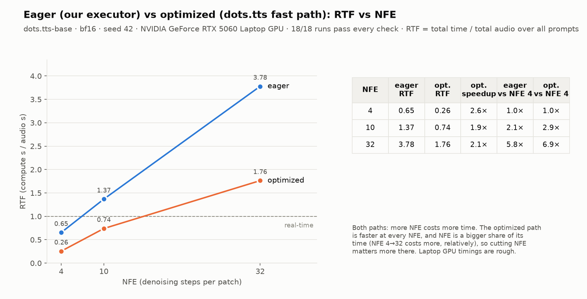

# gpu-executor

Runs dots.tts locally on the GPU at a fixed NFE and owns the DiT denoising loop for every audio patch. In the architecture this is the **Fixed-NFE Euler Executor** box plus the hook into dots.tts that **Local GPU Execution** calls: a GPU worker hands it a prompt + NFE and gets back audio, the per-patch NFE log and timing.

Owners: Tony + Yulchan (executor), Afreed (optimization). Moved here from [adaptive-nfe](https://github.com/Adaptive-Compute-For-TTS/adaptive-nfe) at `c260547` (PRs #1-#6 there); history and old PR discussions stay in that repo.

## Calling it (for gpu-workers / NFE adapter)

```python
import torch
from dots_tts.runtime import DotsTtsRuntime
from adaptive_nfe import generate_fixed_nfe

rt = DotsTtsRuntime.from_pretrained("dots-studio/dots.tts-soar", precision="bfloat16", optimize=False)
torch.manual_seed(42)                      # seeding is the caller's job, same as rt.generate
result = generate_fixed_nfe(rt, nfe=10, text="Hello there.", guidance_scale=1.2)
result.output["audio"], result.output["sample_rate"], result.output["rtf"]
result.num_patches, result.nfe_per_patch   # every entry == 10, or it raises
```

`generate_fixed_nfe` takes the NFE once, freezes it for every patch, runs every patch through the executor, and raises if any patch got a different NFE or skipped the executor. Hooks are restored afterwards, so a plain `rt.generate()` is stock dots.tts again. NFE = dots.tts `num_steps` (team convention; CFG's cond + uncond run in the same DiT call).

## Folders

- `patches/`: our edit to dots.tts (the scheduler and executor hooks) as a git patch, applied to your dots.tts clone
- `src/adaptive_nfe/`: the scheduler (`scheduler.py`), the DiT executor (`executor.py`, `ode.py`), and `generate_fixed_nfe` (`fixed_nfe.py`)
- `scripts/`: setup (`setup_env.sh`), the equivalence test (`check_equivalence.py`), prompt + NFE → WAV (`generate.py`), the ml-evals benchmark runner (`run_benchmark.py`), results CSV → PNGs (`plot_results.py`), `inspect_dit.py` for poking at the DiT
- `tests/`: CPU checks that need no weights, plus `test_fixed_nfe_gpu.py` (real model, skips without CUDA)
- `docs/design/`: executor design (`executor-baseline.md`) and next-phase notes (`batching-exploration.md`)
- `results/`: committed result tables (CSV) and charts (PNG)
- `runs/`: raw outputs (reports, WAVs), gitignored

## How it works

dots.tts makes audio one patch (~160 ms) at a time; each patch is noise turned into a latent by N DiT steps (NFE).

- `patches/dots_tts_scheduler_hook.patch` adds two attributes to dots.tts's model, both `None` by default (= stock dots.tts):
  - `model.nfe_scheduler`: asked for the NFE before every patch (`FixedScheduler(n)` always says n)
  - `model.dit_executor`: runs the patch's DiT loop instead of dots.tts's solver (eager flow matching only for now, errors otherwise)
- `Executor` reuses dots.tts's input prep and DiT forward (`EagerDiTRunner`) and owns the noise draw and the Euler loop (`ode.py`, bit-for-bit the same as torchdiffeq 0.2.5).

Everything here must reproduce stock dots.tts exactly at a fixed NFE, so that later changes in audio come from the NFE choice, not from the plumbing.

## Setup

WSL/Linux only (pynini won't build on Windows). Layout: `main` (this monorepo), `dots.tts` and, for the benchmark prompts, `ml-evals` cloned side by side.

```bash
git clone https://github.com/Adaptive-Compute-For-TTS/main.git
git clone https://github.com/studio-dots-ai/dots.tts.git
git clone https://github.com/Adaptive-Compute-For-TTS/ml-evals.git      # optional: --prompt-id needs it
cd dots.tts && git switch -c scheduler-hook 3cb6f94
git apply ../main/gpu-executor/patches/dots_tts_scheduler_hook.patch
cd ../main/gpu-executor && bash scripts/setup_env.sh && source .venv/bin/activate
```

dots.tts somewhere else: `DOTS_TTS_DIR=/path/to/dots.tts bash scripts/setup_env.sh`. First model run downloads the weights.

## Checks

```bash
pytest tests/                                                    # CPU, no weights (GPU test skips without CUDA)
python scripts/check_equivalence.py --nfe 4 10 32 --executor     # full model: executor vs stock, bit for bit
python scripts/generate.py --prompt-id p004 --nfe 10 --verify-stock
```

`check_equivalence.py`: same seed, for each text and NFE N it runs stock twice (A, A2) and once with `FixedScheduler(N)` + executor (B). B is called with `num_steps=1`, so it only passes if the hook really sets the NFE. Compares every patch and the final audio with `torch.equal` and counts DiT calls per patch. Output in `runs/equivalence/<timestamp>/`.

## Running it

```bash
python scripts/generate.py --prompt-id p004 --nfe 10 --verify-stock     # eager, executor runs the DiT loop
python scripts/generate.py --prompt-id p004 --nfe 10 --optimize         # dots.tts fast path (~3 min compile), stock DiT loop
python scripts/generate.py --prompt-id p001 p004 p007 --nfe 4 10 32 --optimize --verify-stock --run-id opt   # sweep, one model load
python scripts/plot_results.py results/<table>.csv                      # PNGs from a results CSV
```

`generate.py` writes `runs/generate/<run_id>/` per run: `audio.wav`, `config.json`, `metrics.json` (NFE per patch, time, RTF, peak VRAM, checks). `--text`, `--ref-audio`/`--ref-text` also work. Several `--prompt-id`/`--nfe` values run every combination in one process (one discarded warmup per NFE).

`run_benchmark.py` runs the 54 ml-evals prompts with the same settings and output layout as Nishant's `run_baseline.py`, so the output can be scored by quality evals; `--mode stock|scheduler|executor` picks the path. Compare runs with `audio_sha256`, not `wav_sha256`: float WAVs get a timestamped header chunk, so the file hash changes every run.

## Results

All dots.tts commit `3cb6f94`, bf16, seed 42, RTX 5060 Laptop 8 GB, torch 2.8.0+cu128. Laptop timings are rough: read pass/fail first, RTF as a trend.

**Equivalence** (`check_equivalence.py --executor`, dots.tts-base, eager): **all pass**. Every patch and the waveform identical to stock, N DiT calls per patch, every patch through the executor, stock identical to itself.

| text | NFE 4 / 10 / 32 patches |
|---|---|
| "Hello, this is a quick speech synthesis test." | 23 / 22 / 21 |
| "The scheduler decides how many denoising steps each patch of audio receives." | 29 / 27 / 28 |

Patch counts move a bit with NFE because the audio changes, so EOS lands elsewhere.

**Eager vs optimized** (`generate.py --verify-stock`, dots.tts-base, p001/p004/p007 × NFE 4/10/32, both sweeps back to back): **18/18 pass**, each run identical to stock on the same path. Eager: executor on every patch. Optimized (`--optimize`: torch.compile + KV cache): scheduler sets the NFE, dots.tts's own fast loop runs it.

| NFE | eager RTF | optimized RTF | optimized speedup | eager cost vs NFE 4 | optimized cost vs NFE 4 |
|---|---|---|---|---|---|
| 4 | 0.65 | 0.26 | 2.6× | 1.0× | 1.0× |
| 10 | 1.37 | 0.74 | 1.9× | 2.1× | 2.9× |
| 32 | 3.78 | 1.76 | 2.1× | 5.8× | 6.9× |

RTF = total time / total audio over the 3 prompts. Cutting NFE saves time on both paths, relatively more on the optimized one. The paths do slightly different math (fast path: exact 1/NFE grid), so their audio differs from each other; each matches its own stock. Optimized p007 NFE 32 peaked at 9.6 GB on the 8 GB card (WSL spills into shared memory), probably why it sits above the trend. Per-run CSV + charts in `results/`.



## Todo

- executor on the optimized path (adaptive-nfe #7, next PR here): own the fast-path loop, identical to stock `--optimize`
- decide with Yulchan whether `scheduler.py` / `fixed_nfe.py` move to `nfe-adapter/`
- agree the worker ↔ executor interface (inputs, output dict, errors) with gpu-workers, and what telemetry / WAV validation need from it
- run on soar (everything above is dots.tts-base)
